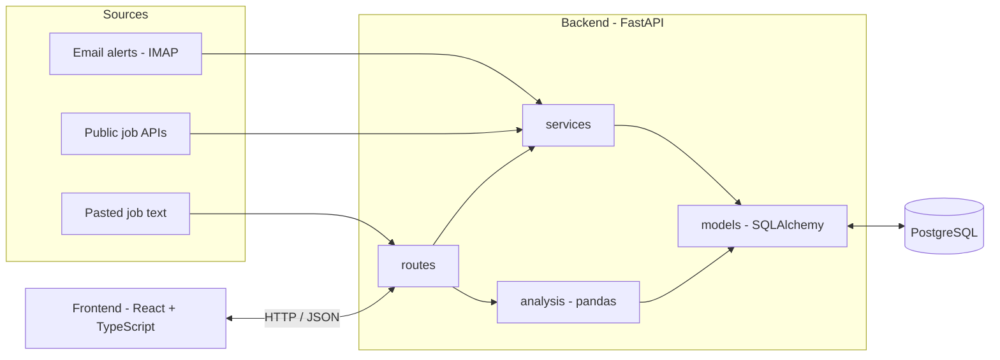
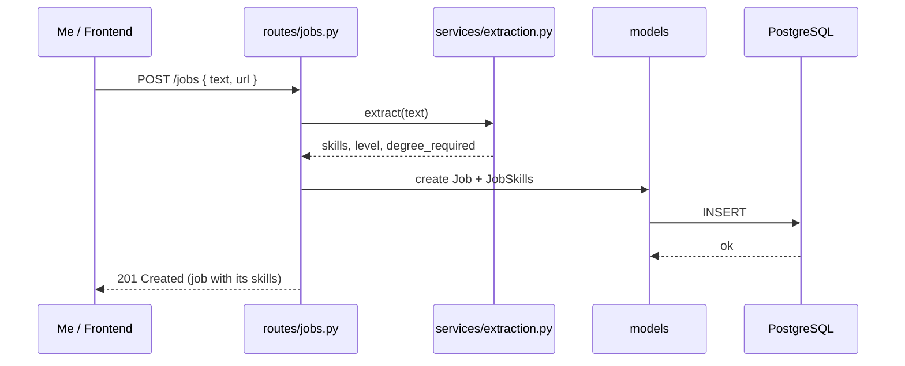
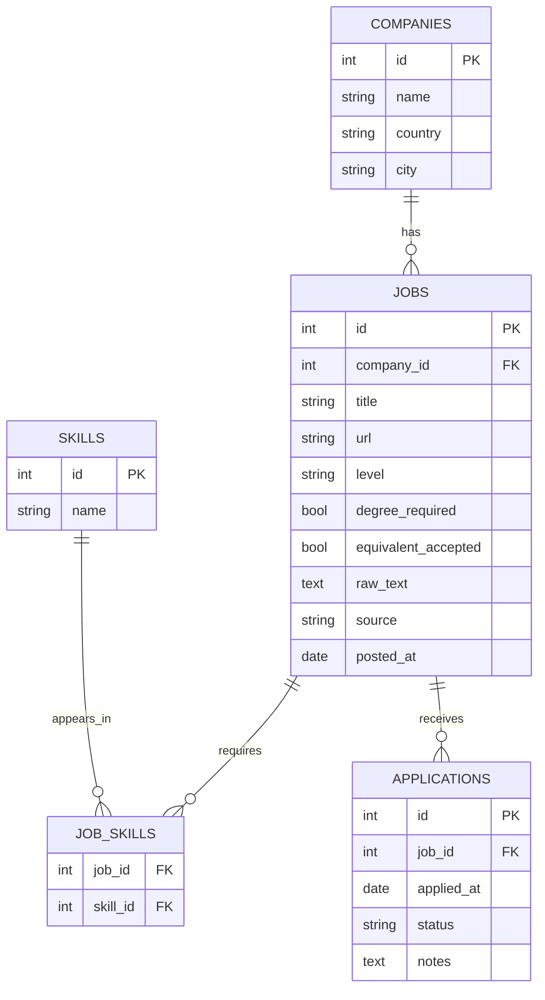

# JobJoby – Architecture

How the project is organized and how the pieces talk to each other. I build only what the current phase of `ROADMAP.md` needs, and create the other folders when I get there.

## 1. Big picture



Everything runs with Docker Compose: `db`, `backend`, and later `frontend`.

## 2. Folder structure

```
JobJoby/
├── backend/
│   ├── app/
│   │   ├── main.py            # creates the FastAPI app and plugs in the routes
│   │   ├── config.py          # reads settings from .env
│   │   ├── db.py              # engine and session (SQLAlchemy)
│   │   ├── models/            # database tables
│   │   ├── schemas/           # request and response shapes (Pydantic)
│   │   ├── routes/            # endpoints, no logic
│   │   ├── services/          # the real logic
│   │   └── analysis/          # pandas reports
│   ├── data/skills.txt        # list of technologies to look for
│   ├── tests/
│   ├── requirements.txt
│   └── Dockerfile
├── frontend/                  # React + TypeScript (phase 8)
├── docker-compose.yml
├── .env.example
├── .gitignore
├── README.md
├── ROADMAP.md
└── ARCHITECTURE.md
```

## 3. What each layer does

| Layer | Job | Should NOT |
|---|---|---|
| `routes` | Receive the request, call a service, return the response | Contain logic or talk to the database directly |
| `schemas` | Define what goes in and out of the API | Know about the database |
| `services` | Extract skills, read emails, call external APIs, save data | Know about HTTP |
| `models` | Describe the tables | Contain business logic |
| `analysis` | pandas reports and stats | Change data |
| `db.py` / `config.py` | Connection and settings | Anything else |

Rule of thumb: dependencies go in one direction.
`routes → services → models → database`. A lower layer never imports a higher one.

## 4. Example: adding a job by pasting the text



## 5. Data model



Notes:
- `JOB_SKILLS` is the link table for the many-to-many between jobs and skills.
- `status` can be: `applied`, `interview`, `rejected`, `no_reply`.
- Add a unique constraint on `skills.name`, and on `jobs.url` to avoid duplicates.
- Add indexes on the columns I filter by (`level`, `company_id`, `status`).

## 6. API endpoints (planned)

| Method | Path | What it does |
|---|---|---|
| POST | `/jobs` | I paste a posting, it extracts the skills and saves it |
| GET | `/jobs` | List jobs, filter with `?skill=`, `?level=`, `?company=` |
| GET | `/jobs/{id}` | One job with its skills |
| POST | `/applications` | Record that I applied |
| PATCH | `/applications/{id}` | Change status or notes |
| GET | `/stats/skills` | Most requested skills |
| GET | `/stats/degree` | % of jobs that require a degree |

## 7. Conventions

- Settings and secrets only in `.env`. Never commit it. Keep `.env.example` updated.
- One thing per file. Split a file when it gets long.
- Clear names: `extract_skills()`, not `process()`.
- Services receive plain data and return plain data, so they are easy to test.
- Write at least a few tests for `services/extraction.py`, it is the core of the project.
- No personal data in test data.

## 8. Build order

I follow `ROADMAP.md`. In short:
1. `config.py`, `db.py`, `models/` and a script that creates the tables.
2. `services/extraction.py` with tests.
3. `routes/` and `schemas/`.
4. `analysis/`.
5. Email alerts and public APIs as new files in `services/`.
6. `frontend/` last.
